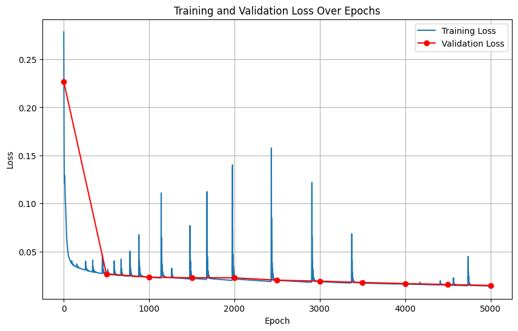
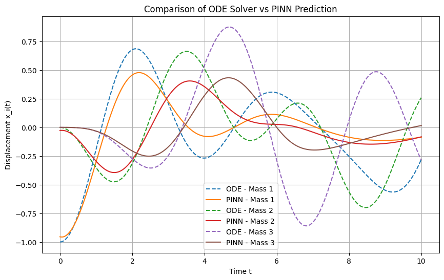

# Physics-Informed Neural Networks for a Coupled Mass–Spring System

A **physics-informed neural network (PINN)** in PyTorch that solves the equations of motion of a chain of masses connected by springs. The network is trained without ground-truth trajectories: the governing differential equations and the initial conditions enter the loss directly. Its solution is then compared with a high-precision numerical ODE solver.

<p align="center">
  
  
</p>

## Approach

| Component | Implementation |
|---|---|
| **System** | N masses on a line, coupled by springs; second-order ODEs for each displacement $x_i(t)$ |
| **Network** | Feed-forward network mapping time $t$ to the vector of positions $(x_1(t), \dots, x_N(t))$ |
| **Physics loss** | ODE residuals at collocation points, with second derivatives computed by automatic differentiation |
| **Constraints** | Initial-position and initial-velocity penalties |
| **Benchmark** | Reference trajectories from a high-precision ODE solver (SciPy) |

## Findings

The loss falls quickly and stays low after the first few hundred epochs. The PINN reproduces the initial dynamics of each mass well but drifts from the reference solution in amplitude and phase over longer horizons. This is a known limitation of plain PINNs on oscillatory systems, and the comparison plot makes it easy to see where the approximation breaks down.

## Repository structure

```
pinn_coupled_mass_spring.ipynb   # data generation, model, physics loss, training, evaluation
figures/                         # selected figures exported from the notebook
```

## Reproducing

```bash
pip install torch numpy scipy matplotlib
```

A GPU speeds up training but is not required.

## Context

Developed for graduate machine-learning coursework at Sharif University of Technology (2025).

---
**Shayan Pourmasoomi** · MSc Economics, Sharif University of Technology · [LinkedIn](https://www.linkedin.com/in/shayan-pourmasoomi-8b6206389)
